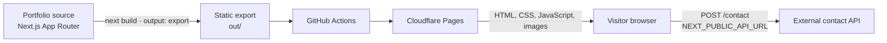

# System Architecture

## Karlos Rivo — Developer Portfolio

This document describes the portfolio as it is currently implemented: its main routes, technology stack, source folders, data flow, and deployment path. The repository contains the Next.js frontend and its assets. The contact form's API is external to this repository.

## 1. High-Level Architecture

The site is built with the Next.js App Router and exported as static files. Cloudflare Pages serves the export; browser-side React components provide navigation, animation, scrolling, and form interactions.



The generated site does not run a Next.js server on Cloudflare Pages. Contact submissions are sent by the browser to `${NEXT_PUBLIC_API_URL}/contact`; the API implementation is not present in this repository. There are no in-repository database, authentication, or API route directories.

## 2. Routes and Page Composition

| URL | Source | Purpose |
| --- | --- | --- |
| `/` | `src/app/page.tsx` | Portfolio home page: hero, featured projects, tech stack, and contact form |
| `/projects/carbonsense` | `src/app/projects/carbonsense/page.tsx` | CarbonSense project details |
| `/projects/finshield` | `src/app/projects/finshield/page.tsx` | FinShield project details |

`src/app/layout.tsx` is the shared root layout. It applies global styles and fonts, and wraps every route with the navigation, footer, and `LenisProvider`.

The home page composes the following components from `src/components/sections/`:

- `Hero` — the animated landing experience, using the hero UI component.
- `FeaturedProjects` — project cards and their local thumbnail images.
- `TechStack` — the portfolio's technologies.
- `Contact` — a client-side form using the contact hook and schema.

`About.tsx` is also present as a section component. The current home route uses the About presentation inside the animated hero UI rather than importing that standalone component.

## 3. Technology Stack

Versions below are those recorded in `pnpm-lock.yaml`.

| Layer | Technology | Role |
| --- | --- | --- |
| Framework | Next.js 16.2.1 App Router | Routing and static site generation |
| UI runtime | React 19.2.4 | Component rendering and browser interactions |
| Language | TypeScript 5.9.3 | Application source and type checking |
| Styling | Tailwind CSS 4.3.3, PostCSS | Utility styling and global CSS |
| Animation | Framer Motion 12.43.0 | Motion and scroll-reveal effects |
| Smooth scrolling | Lenis 1.3.27 | Smooth scroll behavior |
| Icons | Lucide React 1.66.0, React Icons 5.7.0 | Interface icons |
| Validation | Zod 4.6.7 | Contact form field validation |
| Hosting | Cloudflare Pages | Serves the static export |
| CI/CD | GitHub Actions | Builds the site and deploys on pushes to `main` |
| Version control | Git and GitHub | Source history and workflow triggers |

The TypeScript alias `@/*` resolves to `src/*`, as configured in `tsconfig.json`.

## 4. Folder Structure

```text
PORTFOLIO/
├── .github/
│   └── workflows/
│       ├── Portfolio_CI-CD.yml       # Build artifact and Cloudflare Pages deployment
│       └── Test_Portfolio.yml.disabled
├── assets/
│   ├── ME/                           # Personal image assets
│   └── PROJECTS-20261106T012336Z-1-001/
│       └── PROJECTS/                 # Project screenshot/reference archive
│           ├── ANCHORWATCH/
│           ├── CARBONSENSE/
│           ├── DAGUCONNEC/
│           ├── FINSHIELD/
│           ├── PALDEX/
│           ├── Send Notes/
│           └── UCASH/
├── public/                           # Public static files and starter icons
├── src/
│   ├── app/
│   │   ├── images/
│   │   │   ├── Projects/             # Project thumbnails used by the site
│   │   │   ├── KLOGO.png
│   │   │   └── KLOGO.svg
│   │   ├── projects/
│   │   │   ├── carbonsense/
│   │   │   │   └── page.tsx
│   │   │   └── finshield/
│   │   │       └── page.tsx
│   │   ├── globals.css                # Global styles and design tokens
│   │   ├── icon.png
│   │   ├── layout.tsx                 # Shared root layout and metadata
│   │   └── page.tsx                   # Home route composition
│   ├── components/
│   │   ├── layout/                    # Navbar, footer, scrolling helper
│   │   ├── providers/                 # App-level Lenis provider
│   │   ├── sections/                  # Hero, About, projects, stack, contact
│   │   └── ui/                        # Reusable UI, including landing hero
│   ├── hooks/                         # Active section, contact, reveal behavior
│   └── lib/                           # Shared utilities and contact schema
├── next.config.ts                     # Static export configuration
├── tsconfig.json                      # Strict TypeScript and @/* alias
├── eslint.config.mjs                  # ESLint configuration
├── postcss.config.mjs                 # Tailwind PostCSS plugin
├── pnpm-lock.yaml                     # Locked dependency versions
├── pnpm-workspace.yaml                # pnpm build configuration
├── README.md
├── AGENTS.md
└── CLAUDE.md
```

`assets/` is the larger source/reference image archive. `src/app/images/` contains images imported by the website, while `public/` contains files addressable directly from the site root. `.next/` and `node_modules/` are generated/local dependency directories. The configured build output is `out/`.

### Source responsibilities

- `src/app/` owns URL routes, shared page layout, metadata, and global styles.
- `src/components/layout/` contains the persistent site frame and scrolling helpers.
- `src/components/providers/` initializes app-wide client behavior.
- `src/components/sections/` contains the main portfolio content blocks.
- `src/components/ui/` contains lower-level visual components.
- `src/hooks/` keeps reusable client-side state and browser interaction logic out of presentation components.
- `src/lib/` contains shared, non-visual helpers such as `cn()` and the Zod contact schema.

## 5. Data and Interaction Flow

### Portfolio content

Project card metadata is defined in the `FeaturedProjects` component, and the project detail pages are authored as route components. Images used by the pages are imported from `src/app/images/Projects/`; there is no content database or CMS configured in this repository.

### Contact form

1. `Contact.tsx` renders controlled name, email, and message fields.
2. `useContactForm.ts` manages field state, validation feedback, and submission status.
3. `contactSchema.ts` validates the submitted values with Zod.
4. On a valid submission, the browser sends JSON to `${NEXT_PUBLIC_API_URL}/contact`.
5. The external service response drives the success or error message shown by the form.

The API base URL must be available as `NEXT_PUBLIC_API_URL` during the frontend build. The repository does not contain the service that receives the contact request.

### Navigation and motion

The Tech Stack section exposes `id="skills"`. Desktop/mobile Skills links, hero navigation requests and pending targets, initial hash expansion, Lenis/native scrolling, and active-section tracking all recognize `skills` alongside `projects` and `contact`.

`TechStack.tsx` owns a typed 25-item technology catalog and six filter options: All, Databases, Tools, AI, Languages, and Frameworks. Selected-category state derives the visible semantic list, counts, grid columns, cube elevations, and scene height. Native filter buttons expose pressed states and control the list; a polite status region announces counts. Switching categories clears hover/focus/pinned stand state and pointer tilt. FastAPI is deduplicated; HTML and CSS are separate records. Node.js and Blockchain are grouped under Tools; React and Flutter join the broader Frameworks category. No persistence or URL parameter is required for filters.

The catalog renders as six-face CSS 3D cubes. The existing viewport observer and document visibility event suspend CSS float animations offscreen or in background tabs; root motion preferences pause or disable them. Fine-pointer parallax writes local CSS variables from the stationary scene wrapper. It introduces no dependencies, external image assets, canvas, or global animation loop.

Native cube buttons control decorative upright acrylic logo stands. Local hover, keyboard-focus, and pinned-selection state determine the single active technology; `useId` binds each button to its stand. A document pointer listener exists only while a stand is pinned and cleans up on dismissal/unmount. Escape and outside presses dismiss pinned stands. The stand is composed from existing SVG icons and CSS 3D planes, with immediate state changes for paused/reduced motion.

`AboutProfile.tsx` owns the expanded hero's open-text profile, combined education/work card, learning records, decorative systems lettering, and dedicated portrait asset. Its content remains authored in the frontend and statically exported. The `#about` region keeps the hero visibility/inert state and keyboard focus access, without a nested scrollbar or Lenis exclusion. A ResizeObserver measures its intrinsic content height so the expanding card and parent section grow to fit every record, including after responsive reflow. During expansion, the content keeps its final width behind the clipping shell, avoiding repeated paragraph reflow and height-observer feedback. AboutProfile and PortraitIntro are memoized so progress updates do not rerender their static subtrees. Hero touch positions live in refs; gesture listeners change policy only when crossing the Home/About boundary and are passive during ordinary page scrolling. About and the following sections share the page's scroll. Fine-pointer devices use one Lenis instance; touch-first devices use browser-native scrolling and smooth navigation without Lenis touch listeners. Only the collapsed responsive Home intro retains native inner scrolling.

`src/lib/certificates.ts` maps three supplied certificate documents to their SVG previews, original files, dimensions, and display metadata. `CertificatePreview.tsx` is a body portal using the browser's native modal dialog, with a zoomable document viewport, an original-document link, loading/error states, and focus restoration. The `certificatePreviewChange` event pauses/resumes the existing Lenis instance; a root data attribute excludes modal gestures from the hero expansion handlers. The preview locks body/root overflow only for its lifetime and restores the previous values and page position when dismissed. Only the three supplied certificate cards are displayed; the blockchain seminar and the preview's SVG download action are omitted at the user's request.

`scripts/convert-certificates.py` exports static assets into `public/certificates/`: PDF paths and outlined text remain vector where present; PNG artwork is embedded losslessly in SVG. It also copies the unmodified originals and writes a conversion manifest. PyMuPDF and Pillow are offline build-tool dependencies invoked through uv; they are not frontend dependencies or required by the normal Next.js build.

The root layout mounts `LenisProvider`. On fine-pointer devices, its requestAnimationFrame loop runs only during an active Lenis animation and stops while idle, stopped, or hidden; it resets the animation clock when waking. Touch-first devices skip the Lenis instance and use native momentum scrolling and native smooth navigation, preserving the same hero and modal event contracts. The provider also applies MotionConfig reduced-motion preferences. The navigation uses `useActiveSection` to track the active home section, while `useScrollReveal` supplies viewport state to Framer Motion animations. The landing hero also coordinates its Home/About presentation with browser events.

`PortraitIntro` includes three personal cards through `PersonalCard`, with client-side spring tilt and CSS float using the existing Framer Motion dependency. Responsive intro scrolling is native and isolated from Lenis with `data-lenis-prevent`; hero wheel/touch handlers defer to that inner scroll before expanding About. The centered navigation's contact and project actions retain the `heroNavRequest` event contract. All assets and components remain compatible with static export.

## 6. Build and Deployment

`next.config.ts` sets `output: 'export'`, so a production build is expected to produce static files in `out/`. The active GitHub Actions workflow is configured to:

1. Run on pull requests to `main` and pushes to `main`.
2. Set up Node.js 20 and install dependencies.
3. Build the static export with `NEXT_PUBLIC_API_URL` supplied from a GitHub secret.
4. Upload `out/` as a workflow artifact.
5. On pushes to `main`, deploy that artifact to Cloudflare Pages using Wrangler.

## 7. Repository Setup Note

The current repository root contains `pnpm-lock.yaml` but no root `package.json` or `package-lock.json`. The active CI workflow uses `npm ci` and `npm run build`, which expect npm project metadata. Reconcile the package manifest, lockfile, and CI package-manager commands before relying on the automated build and deployment path.


## Appearance and hero motion preferences

The client hook src/hooks/useSitePreferences.ts synchronizes navbar controls and PortraitIntro through useSyncExternalStore, root data-theme/data-motion-paused attributes, and a local preference event. RootLayout restores the two localStorage keys before hydration with a beforeInteractive script. No server state, API, provider dependency, or runtime service is required. PreferenceControls renders matching desktop and mobile icon buttons. Semantic Tailwind color variables switch the existing sections and project routes into light or dark palettes; font variables remain inline aliases.

Theme switching progressively enhances useSitePreferences with a native View Transition and a circular Web Animations clip originating at PreferenceControls. The hook commits DOM attributes and shared React snapshots together, skips superseded transitions, and clears transition state when finished. Reduced/paused motion and missing browser support use the direct preference update. Persistence and static-export behavior are unchanged.
